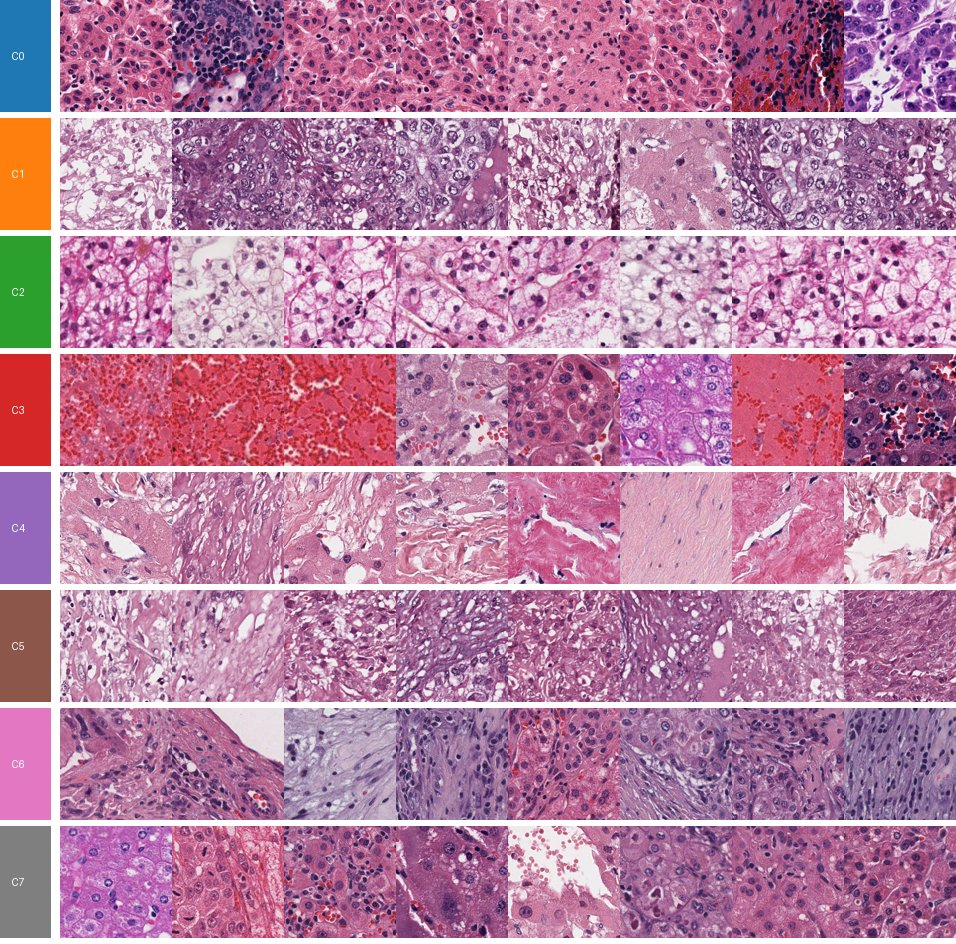
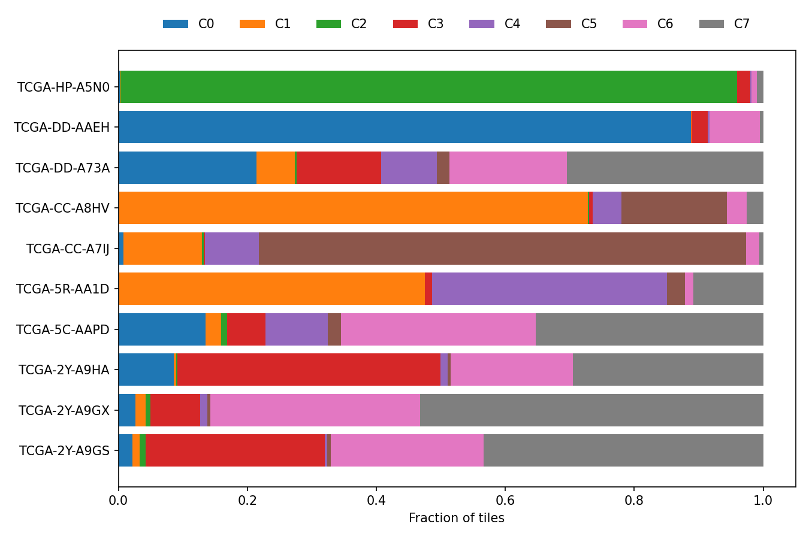
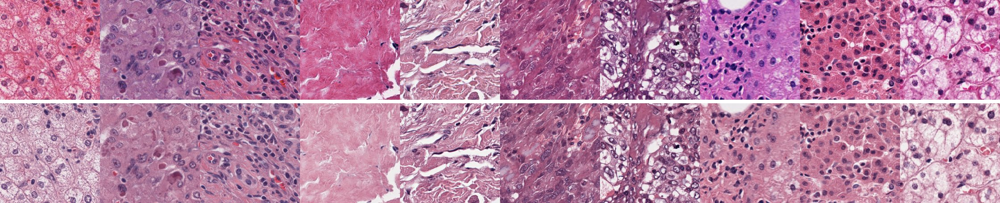

# Site bias in foundation-model features of liver H&E slides

This is a small exploratory study. I had used DINOv2 in my MSc thesis and wanted to learn to work with whole-slide images, which I had not handled before. Starting from a model I already knew let me focus on the new parts: reading the slides, quality control and a careful evaluation.

The question I ended up asking: when a general-purpose foundation model describes tiles of hepatocellular carcinoma, does it group them by tissue or by the hospital the slide came from? It uses 10 diagnostic slides from TCGA-LIHC, frozen DINOv2 features and no labels. Even at this scale there is a clear hospital signature, and stain normalisation removes very little of it.



## Data

- **Slides:** 10 FFPE diagnostic slides from [TCGA-LIHC](https://portal.gdc.cancer.gov/projects/TCGA-LIHC), open access through the GDC API. There is one slide per patient, picked at random within a 150–700 MB size range.
- **Hospitals:** the slides come from 6 tissue source sites. Three come from site 2Y, two from CC and two from DD, and there is one each from 5C, 5R and HP.
- **Resolution:** eight slides were scanned at 40× (~0.25 µm/px) and two at 20× (0.5 µm/px).

## Pipeline

| Step | Script | What it does |
|---|---|---|
| 1 | `download_tcga_lihc.py` | Queries the GDC, picks the slides and downloads them. Downloads are resumable and every file is checked against its MD5. |
| 2 | `tile_slides.py` | Detects tissue on a thumbnail (Otsu on saturation, minus pen marks). It tiles at 224 px and 0.5 µm/px, then checks each tile for background, marker ink and blur. Up to 2,000 tiles are checked per slide. |
| 3 | `extract_features.py` | Computes DINOv2 ViT-B/14 CLS embeddings (768-d). With `--macenko`, every tile is first mapped to a reference H&E stain, using one stain estimate per slide. |
| 4 | `tissue_maps.py` | Clusters all slides together: L2 normalisation, 50 PCs, k-means with k = 8. It draws a map per slide, a gallery of example tiles per cluster and the cluster composition of each slide. |
| 5 | `compare.py` | Measures how strongly the tiles group by slide and by hospital, for raw versus normalised features. |

After QC, **19,565 tiles** were kept, between 1,837 and 1,996 per slide (`results/tiles_summary.csv`).

## Results

### What the clusters look like

Below is my reading of the gallery at the top of this page. I am not a pathologist, so these are working labels:

| Cluster | Looks like | Spread over slides |
|---|---|---|
| C7 | tumour hepatocytes (large nuclei, prominent nucleoli) | 6 slides |
| C6 | cellular fibrous stroma, septa | 6 slides |
| C4 | loose collagen, low cellularity | 5 slides |
| C3 | blood / haemorrhage | 5 slides |
| C2 | clear, vacuolated cells | 97% from one slide (HP-A5N0) |
| C5 | dense mixed tumour / stroma | 76% from one slide (CC-A7IJ) |
| C0 | eosinophilic hepatocytes, some lymphocytes | 65% from one slide (DD-AAEH) |
| C1 | pale cells, purple staining | mostly CC-A8HV and 5R-AA1D |

The clusters shared across slides look like tissue types. The others are each owned by one or two slides.



### Slide and hospital signature

To measure this, I took 5,000 tiles at random and looked at each tile's 10 nearest neighbours in PCA space:

| | Neighbours from the same slide | Chance | Neighbours from another slide that share its hospital | Chance |
|---|---|---|---|---|
| Raw | **0.92** | 0.10 | **0.63** | 0.18 |
| Macenko | **0.88** | 0.10 | **0.56** | 0.18 |

The last two columns are the more interesting ones. They only use hospitals with more than one slide, so they look past differences between patients. When a tile's neighbour comes from a different patient, that patient was treated at the same hospital 63% of the time, against 18% expected by chance.

### Stain normalisation helps the eye more than the model

Macenko normalisation does what it should visually: very red or very purple slides end up with a similar H&E (top row raw, bottom row normalised).



The features barely move, though. Same-slide neighbours drop from 0.92 to 0.88 and same-hospital neighbours from 0.63 to 0.56. The same slides still own their own clusters (`figures/composition_macenko.png`). Colour is part of the site signature, but only a small part of it. The rest has to come from something colour normalisation does not touch, such as scanner optics and focus, compression, section thickness and tissue processing, or the case mix of each hospital.

Some slide-specific clusters survive normalisation and look morphologically distinct, for example the clear-cell pattern of HP-A5N0. They may be real biology of that tumour rather than artefact. That would need a pathologist to look at it.

## Limitations

- **Ten slides is a pilot, not a cohort.** I kept it to what fits on a normal disk and a 4 GB GPU (~5 GB of slides). The unit that matters is the slide and the hospital (10 and 6), not the 19,565 tiles. That is enough to detect an effect this large, but not to estimate its size precisely. The pipeline runs unchanged on more slides.
- **Patient, case mix and site cannot be fully separated.** Ten slides is very few, there is one slide per patient, and only three hospitals contribute more than one slide. Patients from the same hospital may also share aetiology or tumour type.
- **The cluster names are my own visual reading,** not annotations.
- **One run of a fairly arbitrary setup:** 2,000 random tiles per slide, one seed and k = 8.
- **DINOv2 was trained on natural images.** A pathology foundation model could behave quite differently, which is the obvious next experiment.
- **Resolution differs between scans.** Tiles from 40× slides are downsampled to 0.5 µm/px and tiles from 20× slides are not, which may add a scanner-specific difference of its own.

## Notes from building it

- **The first ink detector was wrong.** It flagged pixels that were "bluer than red" as marker, which also matches hematoxylin. On DD-A73A it marked 1,706 of the 2,000 tiles as ink, and 481 on 5C-AAPD. Moving to a hue window fixed it, because hematoxylin sits around hue 0.70–0.75 and blue ink around 0.60. The column `kept_first_ink_rule` in `results/tiles_summary.csv` shows the difference.
- **Two slides were scanned at 20×,** so the tile size at level 0 is computed from the mpp instead of being fixed.
- **The GDC often drops long downloads.** The downloader retries with back-off and resumes from the partial file.

## Next steps

- Repeat the comparison with a pathology foundation model (UNI, Virchow or similar).
- Use more slides per hospital, so that site and case mix can be separated better.
- Run a slide-level task with attention-based MIL, using splits by patient and by site.

## Running it

```bash
pip install -r requirements.txt
python download_tcga_lihc.py                 # ~5 GB for 10 slides
python tile_slides.py
python extract_features.py
python extract_features.py --macenko
python tissue_maps.py
python tissue_maps.py --features out/features_macenko --out out/maps_macenko
python compare.py
```

Slides go to `data/` and everything derived from them to `out/`. Neither is tracked. The figures and tables in this README are in `figures/` and `results/`.

The slides are open-access TCGA data from the GDC and are not redistributed here. The code is under the MIT License.

José Carlos León Miguel · [github.com/jcleonmiguel](https://github.com/jcleonmiguel)
